<p align="center">
  <picture>
    <source media="(prefers-color-scheme: dark)" srcset="docs/assets/fair-chemistry-logo-dark-mode.png">
    <source media="(prefers-color-scheme: light)" srcset="docs/assets/fair-chemistry-logo-light-mode.png">
    
  </picture>
</p>

<h4 align="center">


[](https://codecov.io/gh/facebookresearch/fairchem)
[](https://doi.org/10.5281/zenodo.15587498)

[](https://github.com/codespaces/new/facebookresearch/fairchem?quickstart=1)

</h4>

# `fairchem` by the FAIR Chemistry team

`fairchem` is the [FAIR](https://ai.meta.com/research/) Chemistry's centralized repository of all its data, models,
demos, and application efforts for materials science and quantum chemistry.

- [UMA performance](#uma-is-now-much-faster)
- [Latest news](#latest-news)
- [Installation](#installation)
- [Quick Start](#quick-start)
  - [Pretrained models](#instantiate-a-calculator-from-a-pretrained-model)
  - [Tasks](#set-the-task-for-your-application-and-calculate)
  - [Inorganic crystal relaxation](#relax-an-inorganic-crystal)
  - [Molecular dynamics](#run-molecular-dynamics-md)
  - [D3 dispersion corrections](#d3-dispersion-corrections)
  - [Multi-GPU inference and LAMMPS](#multi-gpu-inference-and-lammps)
- [License](#license)

## UMA is now much faster!

<p align="center">
  <a href="benchmarks/omol/README.md">
    
  </a>
</p>

Uma-nitro brings blazing speedups to UMA. Currently it is only supported on Nvidia Ampere GPUs and above. Speed is heavily optimized on Hopper series and above for single-gpu single-system mode. Stay tuned as bring nitro support for multi-gpu and batch modes.

The vertical axis is force MAE (meV/Å) on the public OMol25 validation set; the
horizontal axis is MD speed (ns/day at a 1 fs timestep) from the mean runtime of an ASE
NVE step on a 1000-atom silicon cell using an NVIDIA H200. See the
[benchmark details and reproduction scripts](benchmarks/omol/README.md)
for the full setup.

For more OMol model accuracy benchmarks, you can also see the
[FAIR Chemistry leaderboard](https://huggingface.co/spaces/facebook/fairchem_leaderboard).

Please use this logo for references to [UMA](docs/assets/uma-diagram-light-mode.png)!

## Latest news

### October 2026

- **UMA Nitro**, the new default inference mode, is much faster than turbo for molecular dynamics and relaxations on a single GPU.
  On a single NVIDIA H200, it reaches **~6 ns/day for 1,000 atoms** in ASE MD
  and raw inference throughput equivalent to **~33 ns/day for 150 atoms**,
  with support for systems up to **15,000 atoms**.
  Special thanks to Emanuele Arcelli and Max Zhdanov (for their [FlashUMA work](https://github.com/ArcelliEmanuele/flash-uma)), Carole-Jean Wu, Christian Puhrsch, Zachary DeVito, Aditya Venkataraman, Michael Lazos, and Animesh Jain, all of whom contributed to and helped improve UMA Nitro.
  See [UMA Nitro](https://facebookresearch.github.io/fairchem/ase-calculator#default-mode-nitro).
- **Two new UMA-S-1.2.1 models**: `uma-s-1p2p1-ft-d4rev` for molecules (ωB97M-D4rev) and
  `uma-s-1p2p1-ft-r2scan` for materials (r²SCAN, trained on [MAD-1.6](https://arxiv.org/abs/2603.02089)). These improve a wide range of observables compared to experiments. Please be aware of their [limitations](https://facebookresearch.github.io/fairchem/uma#uma-s-1p2p1-fine-tunes).
- **DFT-D3(BJ) dispersion (including GPU support)** for any ASE calculator, with PBE and r²SCAN presets. These make the respective materials tasks significantly more transferable outside of solid-state systems. See
  [D3 dispersion corrections](#d3-dispersion-corrections).

### September 2026

Read our new paper on
[quantum-accurate atomistic modeling of enzyme catalysis using a machine-learned potential](https://arxiv.org/abs/2609.09293).


### June 2026

UMA playground released, try the interactive [educational demo](https://aidemos.atmeta.com/uma) here yourself!


### March 2026

UMA-1.2 released! ~50% faster, ~40% more accurate on Open Molecules test set, and expanded data coverage for catalysts (oxides and interfaces), molecules, and polymers!

### October 2025

[check out our seamless Multi-node, Multi-GPU and LAMMPs interfaces to run large scale dynamics!](#multi-gpu-inference-and-lammps)

### June 2025

UMA/OMol first released! Read about the [UMA model and OMol25 dataset](https://ai.meta.com/blog/meta-fair-science-new-open-source-releases/) release.

## Installation
Although not required, we highly recommend installing using a package manager and virtualenv such as [uv](https://docs.astral.sh/uv/getting-started/installation/#standalone-installer), it is much faster and better at resolving dependencies than standalone pip.

Install fairchem-core using pip
```bash
pip install fairchem-core
```

If you want to contribute or make modifications to the code, clone the repo and install in edit mode
```bash
git clone git@github.com:facebookresearch/fairchem.git

pip install -e fairchem/packages/fairchem-core[dev]
```

## Quick Start
The easiest way to use pretrained models is via the [ASE](https://wiki.fysik.dtu.dk/ase/) `FAIRChemCalculator`.
A single uma model can be used for a wide range of applications in chemistry and materials science by picking the
appropriate task name for domain specific prediction.

### Instantiate a calculator from a pretrained model
Make sure you have a Hugging Face account, have already applied for model access to the
[UMA model repository](https://huggingface.co/facebook/UMA), and have logged in to Hugging Face using an access token.
You can use the following to save an auth token,
```bash
huggingface-cli login
```

Models are referenced by their name, below are the currently supported models:

| Model Name | Description |
|---|---|
| uma-s-1p2p1 | Latest version of the UMA small model, fastest of the UMA models while still SOTA on most benchmarks (6.6M/290M active/total params) |
| uma-s-1p2p1-ft-d4rev | UMA-S-1.2.1 fine-tuned to ωB97M-D4rev for molecular systems; `omol` task only. See [new models](https://facebookresearch.github.io/fairchem/uma#uma-s-1p2p1-fine-tunes) |
| uma-s-1p2p1-ft-r2scan | UMA-S-1.2.1 fine-tuned on r²SCAN data ([MAD-1.6](https://arxiv.org/abs/2603.02089)) for inorganic materials and beyond; `omat` task only, not spin-polarized. See [new models](https://facebookresearch.github.io/fairchem/uma#uma-s-1p2p1-fine-tunes) |
| uma-m-1p1 | Best in class UMA model across all metrics, but slower and more memory intensive than uma-s (50M/1.4B active/total params) |

### Set the task for your application and calculate

- **oc20:** use this for catalysis
- **oc22:** use this for oxide catalysis (>1p2)
- **oc25:** use this for (electro)catalysis (>1p2)
- **omat:** use this for inorganic materials
- **omol:** use this for molecules+polymers
- **odac:** use this for MOFs
- **omc:** use this for molecular crystals

#### Relax an adsorbate on a catalytic surface,
```python
from ase.build import fcc100, add_adsorbate, molecule
from ase.optimize import LBFGS
from fairchem.core import pretrained_mlip, FAIRChemCalculator

predictor = pretrained_mlip.get_predict_unit("uma-s-1p2p1", device="cuda")
calc = FAIRChemCalculator(predictor, task_name="oc20")

# Set up your system as an ASE atoms object
slab = fcc100("Cu", (3, 3, 3), vacuum=8, periodic=True)
adsorbate = molecule("CO")
add_adsorbate(slab, adsorbate, 2.0, "bridge")

slab.calc = calc

# Set up LBFGS dynamics object
opt = LBFGS(slab)
opt.run(0.05, 100)
```

#### Relax an inorganic crystal,
```python
from ase.build import bulk
from ase.optimize import FIRE
from ase.filters import FrechetCellFilter
from fairchem.core import pretrained_mlip, FAIRChemCalculator

predictor = pretrained_mlip.get_predict_unit("uma-s-1p2p1", device="cuda")
calc = FAIRChemCalculator(predictor, task_name="omat")

atoms = bulk("Fe")
atoms.calc = calc

opt = FIRE(FrechetCellFilter(atoms))
opt.run(0.05, 100)
```

> [!WARNING]
> **Materials Project and OMat24 DFT settings:** OMat24-trained UMA and legacy
> inorganic models use DFT and DFT+U total-energy labels that are not compatible
> with Materials Project calculations. Use the OMat24 reference unary compounds
> and MP2020-style anion and GGA/GGA+U mixing corrections from the
> [OMat24 Hugging Face repository](https://huggingface.co/datasets/facebook/OMAT24).
> Do not apply Materials Project reference compounds or MP2020 corrections
> directly. Take care when comparing formation energies or energies above hull
> with Materials Project results: pseudopotentials differ, and magnetic ground
> states may differ as well.

#### Run Molecular Dynamics (MD)
Note: `pretrained_mlip.get_predict_unit()` currently uses a seed to set the global state of the numpy RNG. In order to obtain different trajectories for different runs of the following code, we have to set a random seed as shown below:
```python
import numpy as np
from ase import units
from ase.io import Trajectory
from ase.md.langevin import Langevin
from ase.build import molecule
from fairchem.core import pretrained_mlip, FAIRChemCalculator

seed = np.random.randint(0, np.iinfo(np.int32).max, dtype=int)
# the default inference mode (nitro) is the fastest for MD on a single GPU
predictor = pretrained_mlip.get_predict_unit("uma-s-1p2p1", device="cuda", seed=seed)
calc = FAIRChemCalculator(predictor, task_name="omol")

atoms = molecule("H2O")
atoms.calc = calc

dyn = Langevin(
    atoms,
    timestep=0.1 * units.fs,
    temperature_K=400,
    friction=0.001 / units.fs,
)
trajectory = Trajectory("my_md.traj", "w", atoms)
dyn.attach(trajectory.write, interval=1)
dyn.run(steps=1000)
```

#### Calculate a spin gap,
```python
from ase.build import molecule
from fairchem.core import pretrained_mlip, FAIRChemCalculator

predictor = pretrained_mlip.get_predict_unit("uma-s-1p2p1", device="cuda")

#  singlet CH2
singlet = molecule("CH2_s1A1d")
singlet.info.update({"spin": 1, "charge": 0})
singlet.calc = FAIRChemCalculator(predictor, task_name="omol")

#  triplet CH2
triplet = molecule("CH2_s3B1d")
triplet.info.update({"spin": 3, "charge": 0})
triplet.calc = FAIRChemCalculator(predictor, task_name="omol")

triplet.get_potential_energy() - singlet.get_potential_energy()
```

#### D3 dispersion corrections
`DFTD3Calculator` adds GPU-accelerated DFT-D3(BJ) energies, forces and analytic stresses (via `nvalchemiops`) to any
ASE calculator. For example, use `functional="pbe"` for PBE-trained heads and `functional="r2scan"` for `uma-s-1p2p1-ft-r2scan`.

```python
from fairchem.core import DFTD3Calculator, FAIRChemCalculator, pretrained_mlip

predictor = pretrained_mlip.get_predict_unit("uma-s-1p2p1", device="cuda")
calc = DFTD3Calculator(
    FAIRChemCalculator(predictor, task_name="omat"), functional="pbe", device="cuda"
)
```

See the [D3 docs](https://facebookresearch.github.io/fairchem/ase-calculator#adding-a-dft-d3-bj-dispersion-correction) for the
parameters and references.

#### Multi-GPU Inference and LAMMPs
If you have multiple gpus (or multiple nodes), we handle all the parallelism for you under the hood by a single flag (workers=N). Use `inference_settings="multigpu"` (formerly `turbo`) with `workers > 1`, since the default (nitro) runs on a single GPU. This is also compatible with LAMMPs to perform large scale MD. See our [docs](https://facebookresearch.github.io/fairchem/summary) for more details. This requires the Ray package to be installed and comes with the extras bundle.
```
pip install fairchem-core[extras]
```

```python
import time

import numpy as np
from ase import units
from ase.md.langevin import Langevin
from fairchem.core import pretrained_mlip, FAIRChemCalculator

from fairchem.core.datasets.common_structures import get_fcc_crystal_by_num_atoms

seed = np.random.randint(0, np.iinfo(np.int32).max, dtype=int)
predictor = pretrained_mlip.get_predict_unit(
    "uma-s-1p2p1",
    inference_settings="multigpu",
    device="cuda",
    workers=8,
    seed=seed,
)
calc = FAIRChemCalculator(predictor, task_name="omat")

atoms = get_fcc_crystal_by_num_atoms(8000)
atoms.calc = calc

dyn = Langevin(
    atoms,
    timestep=0.1 * units.fs,
    temperature_K=400,
    friction=0.001 / units.fs,
)
# warmup 10 steps
dyn.run(steps=10)
start_time = time.time()
dyn.attach(
    lambda: print(
        f"Step: {dyn.get_number_of_steps()}, E: {atoms.get_potential_energy():.3f} eV, "
        f"QPS: {dyn.get_number_of_steps()/(time.time()-start_time):.2f}"
    ),
    interval=1,
)
dyn.run(steps=1000)
```

### LICENSE
`fairchem` is available under a [MIT License](LICENSE.md). Models/checkpoint licenses vary by application area.
